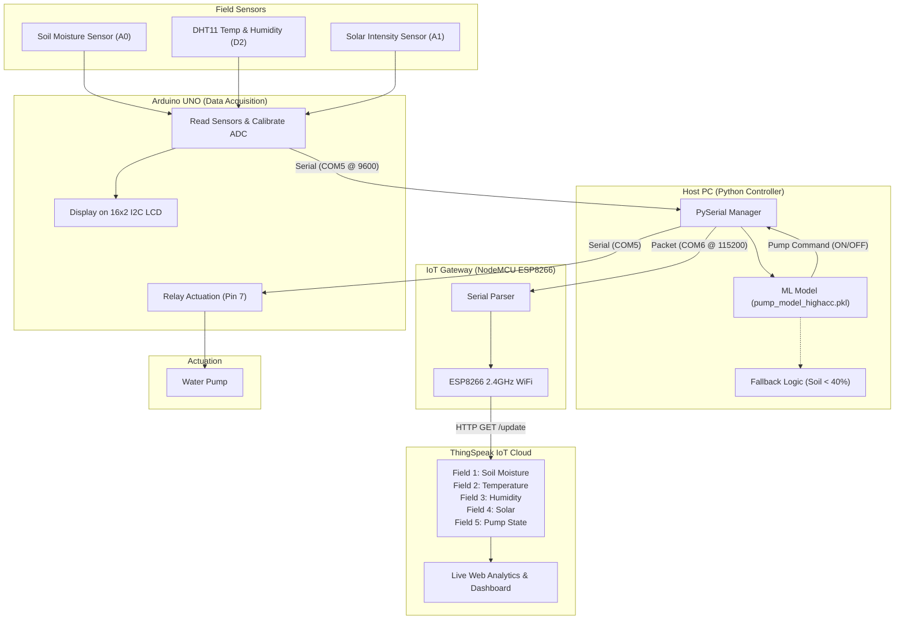

# 🌱 Smart Irrigation System using IoT & Machine Learning

[](https://github.com/salmanm-11/Smart-Irrigation-System-IoT)
[](https://www.python.org/)
[](https://www.arduino.cc/)
[](https://www.espressif.com/)
[](https://thingspeak.mathworks.com/)
[](https://scikit-learn.org/)

An automated, intelligent irrigation system integrating Arduino microcontrollers, environmental sensors, an intelligent Machine Learning decision engine, and a NodeMCU ESP8266 Wi-Fi module for live IoT telemetry on ThingSpeak.

---

## 📑 Table of Contents
1. [Project Overview](#1-project-overview)
2. [Objectives](#2-objectives)
3. [Technologies Used](#3-technologies-used)
4. [Hardware Components](#4-hardware-components)
5. [Circuit Diagram](#5-circuit-diagram)
6. [System Architecture](#6-system-architecture)
7. [How It Works](#7-how-it-works)
8. [Installation & Setup](#8-installation--setup)
9. [IoT Cloud Monitoring (ThingSpeak)](#9-iot-cloud-monitoring-thingspeak)
10. [Project Benefits](#10-project-benefits)
11. [Future Enhancements](#11-future-enhancements)

---

## 1. Project Overview
Water conservation and precision farming are crucial for sustainable agriculture. Traditional irrigation methods often lead to water wastage through scheduled or manual watering regardless of actual soil moisture levels and environmental factors.

This **Smart Irrigation System** solves this problem by creating a closed-loop automated system:
- **Arduino UNO** collects environmental data (soil moisture, temperature, humidity, sunlight intensity) and renders it on a local 16x2 I2C LCD.
- A **Python Control Script (`controll.py`)** receives the telemetry over Serial, evaluates environmental parameters against a trained **Machine Learning Model (`pump_model_highacc.pkl`)** (with automatic rule-based fallback), and returns an automated ON/OFF command to control the water pump relay.
- A **NodeMCU ESP8266** module bridges the sensor data and pump status to the **ThingSpeak Cloud**, enabling remote, real-time crop monitoring for farmers from any device anywhere in the world.

---

## 2. Objectives
- **Water & Energy Conservation**: Prevent over-watering and dry-soil stress by actuating the pump only when strictly necessary.
- **Intelligent Predictive Actuation**: Utilize Machine Learning to evaluate multiple environmental features simultaneously (Soil Moisture, Temperature, Humidity, and Solar Irradiance).
- **Multi-layered Reliability**: Built-in rule-based fallback mechanism (Soil Moisture < 40%) in case of ML model unavailability.
- **Remote Cloud Visibility**: Allow farmers and operators to observe environmental conditions and irrigation activity live via ThingSpeak IoT dashboards.
- **Cost-effective & Scalable**: Built using accessible off-the-shelf microcontrollers and standard agricultural sensors.

---

## 3. Technologies Used

### Hardware
- **Arduino UNO** (Microcontroller & Sensor Interface)
- **NodeMCU ESP8266** (Wi-Fi IoT Gateway)
- **Capacitive/Resistive Soil Moisture Sensor**
- **DHT11 Temperature & Humidity Sensor**
- **Solar / LDR Sensor**
- **5V Single Channel Relay Module**
- **12V / 5V Submersible Water Pump**
- **16x2 I2C LCD Display (PCF8574)**

### Software & Cloud
- **C / C++ (Arduino IDE)**: Firmware for Arduino UNO and NodeMCU ESP8266
- **Python 3**: Brain controller for serial communication and machine learning inference
- **Libraries**:
  - `pyserial`: Serial communication between PC, Arduino, and NodeMCU
  - `joblib`: ML model serialization and loading
  - `pandas` & `numpy`: Data manipulation
  - `scikit-learn`: Predictive classification model
- **ThingSpeak IoT Cloud**: Cloud telemetry logging and data visualization

---

## 4. Hardware Components

| Component | Quantity | Purpose |
| :--- | :---: | :--- |
| **Arduino UNO** | 1 | Sensor data acquisition, LCD driver, and pump relay trigger |
| **NodeMCU ESP8266** | 1 | 2.4GHz Wi-Fi communication and ThingSpeak HTTP client |
| **DHT11 Sensor** | 1 | Ambient temperature and relative humidity measurement |
| **Soil Moisture Sensor** | 1 | Measures volumetric water content in soil |
| **Solar / LDR Sensor** | 1 | Measures solar radiation / light intensity |
| **5V Relay Module** | 1 | Electrically isolated switch for the water pump motor |
| **Submersible Water Pump** | 1 | Pumping irrigation water from reservoir to crops |
| **16x2 LCD with I2C Module** | 1 | Local real-time status display |
| **External Power Supply / Battery** | 1 | Powering pump, relay, and microcontrollers |
| **Breadboard & Jumper Wires** | - | Interconnections |

---

## 5. Circuit Diagram

Detailed schematic visual is included in the project documentation:
📄 **[Smart_Irrigation_Brochure_With_Circuits.pdf](Smart_Irrigation_Brochure_With_Circuits.pdf)**

### Pin Connection Reference

#### 1. DHT11 Sensor
- `VCC` ➔ Arduino `3.3V` / `5V`
- `GND` ➔ Arduino `GND`
- `DATA` ➔ Arduino `Digital Pin 2`

#### 2. Soil Moisture Sensor
- `VCC` ➔ Arduino `3.3V` / `5V`
- `GND` ➔ Arduino `GND`
- `AOUT` ➔ Arduino `Analog Pin A0`

#### 3. Solar / LDR Sensor
- `+` (VCC) ➔ Arduino `5V`
- `DATA / Signal` ➔ Arduino `Analog Pin A1`
- `-` (GND) ➔ Arduino `GND` (via pull-down resistor)

#### 4. 5V Relay Module
- `VCC` ➔ Arduino `5V`
- `GND` ➔ Arduino `GND`
- `IN` ➔ Arduino `Digital Pin 7`
- `COM` / `NO` ➔ Wired in series with Water Pump and external DC power source

#### 5. 16x2 I2C LCD Display
- `VCC` ➔ Arduino `5V`
- `GND` ➔ Arduino `GND`
- `SDA` ➔ Arduino `Analog Pin A4`
- `SCL` ➔ Arduino `Analog Pin A5`

#### 6. Host & IoT Communications
- **Arduino UNO**: Connected via USB Cable to Host PC (`COM5` at 9600 baud)
- **NodeMCU ESP8266**: Connected via USB Cable to Host PC (`COM6` at 115200 baud)

---

## 6. System Architecture



---

## 7. How It Works

1. **Environmental Sensing**:
   - Every 2 seconds, Arduino reads the Soil Moisture sensor (`A0`), DHT11 temperature and humidity (`D2`), and solar intensity (`A1`).
   - Soil ADC values are converted to percentage values ($0\% = \text{Dry}$, $100\% = \text{Wet}$) based on calibrated thresholds (`SOIL_DRY = 674`, `SOIL_WET = 229`).
2. **Local Display**:
   - Values are continuously updated on the 16x2 LCD display for on-site monitoring.
3. **Serial Stream to Python**:
   - Arduino sends formatted packets over serial:
     ```text
     SOIL,<val>,TEMP,<val>,HUM,<val>,SOLAR,<adc>
     ```
4. **Intelligent Machine Learning Decision Engine**:
   - `controll.py` receives the packet and feeds the four features (`Soil`, `Temp`, `Hum`, `Solar`) into `pump_model_highacc.pkl`.
   - The model predicts whether irrigation is required (`ON` or `OFF`) along with its confidence score.
   - If the model is not found, the script safely falls back to a deterministic rule: if Soil Moisture < 40%, turn pump `ON`, otherwise `OFF`.
5. **Pump Actuation**:
   - The decision (`ON` or `OFF`) is sent back via Serial to the Arduino UNO.
   - The Arduino toggles the Relay Module (Active LOW) to start or stop the water pump.
6. **Cloud Telemetry**:
   - Python forwards the complete status packet to NodeMCU ESP8266:
     ```text
     SOIL,<val>,TEMP,<val>,HUM,<val>,SOLAR,<val>,PUMP,<ON/OFF>
     ```
   - NodeMCU parses the line and sends an HTTP request to the ThingSpeak Cloud REST API.

---

## 8. Installation & Setup

### 1. Prerequisites
- **Arduino IDE**: [Download here](https://www.arduino.cc/en/software)
- **Python 3.8+**: [Download here](https://www.python.org/)
- **ThingSpeak Account**: [Sign up here](https://thingspeak.mathworks.com/)

### 2. Arduino IDE Setup
Install the following libraries using the Arduino Library Manager (`Sketch` ➔ `Include Library` ➔ `Manage Libraries...`):
- `LiquidCrystal_I2C` by Frank de Brabander
- `DHT sensor library` by Adafruit
- `Adafruit Unified Sensor`

Add the ESP8266 Board Manager URL (`File` ➔ `Preferences`):
```
http://arduino.esp8266.com/stable/package_esp8266com_index.json
```
Install **esp8266** by ESP8266 Community in the Boards Manager.

### 3. Flash Microcontrollers
1. Open `arduino code.txt` in Arduino IDE, select your Arduino UNO board and COM port (e.g. `COM5`), and click **Upload**.
2. Open `node code.txt` in Arduino IDE, select `NodeMCU 1.0 (ESP-12E Module)` and its COM port (e.g. `COM6`).
3. Update your Wi-Fi credentials and ThingSpeak API Key in `node code.txt`:
   ```cpp
   const char* ssid = "YOUR_WIFI_SSID";
   const char* pass = "YOUR_WIFI_PASSWORD";
   String apiKey = "YOUR_THINGSPEAK_WRITE_API_KEY";
   ```
4. Click **Upload**.

### 4. Python Environment Setup
1. Clone this repository:
   ```bash
   git clone https://github.com/salmanm-11/Smart-Irrigation-System-IoT.git
   cd Smart-Irrigation-System-IoT
   ```
2. Create and activate a virtual environment (optional but recommended):
   ```bash
   python -m venv venv
   # On Windows:
   venv\Scripts\activate
   # On Linux/macOS:
   source venv/bin/activate
   ```
3. Install required Python packages:
   ```bash
   pip install -r requirements.txt
   ```
4. In `controll.py`, check and match the COM ports detected on your machine:
   ```python
   arduino = serial.Serial('COM5', 9600, timeout=1)
   nodemcu = serial.Serial('COM6', 115200, timeout=1)
   ```
5. Run the control system:
   ```bash
   python controll.py
   ```

---

## 9. IoT Cloud Monitoring (ThingSpeak)

The system posts live updates to ThingSpeak under five organized data channels:

| Field | Parameter | Description | Unit |
| :---: | :--- | :--- | :---: |
| **Field 1** | Soil Moisture | Current moisture level in root zone | `%` |
| **Field 2** | Temperature | Ambient environmental temperature | `°C` |
| **Field 3** | Humidity | Relative humidity of air | `%` |
| **Field 4** | Solar Intensity | Sunlight / irradiance level | `%` |
| **Field 5** | Pump Status | Current status of irrigation pump | `ON / OFF` |

### Setting Up Your ThingSpeak Channel
1. Log in to [ThingSpeak](https://thingspeak.mathworks.com/).
2. Create a **New Channel** named `Smart Irrigation System`.
3. Enable Fields 1 through 5 as listed in the table above.
4. Copy the **Write API Key** from the `API Keys` tab and paste it into `node code.txt`.
5. View real-time line charts, gauges, and status widgets directly in your dashboard or on mobile.

---

## 10. Project Benefits
- 💧 **Water Conservation**: Reduces irrigation water waste by up to 40-50% compared to traditional timer-based methods.
- ⚡ **Energy Efficiency**: Reduces unnecessary pump cycling, lowering electricity costs and extending pump lifespan.
- 🧠 **Predictive Decision Making**: Uses multi-sensor machine learning rather than relying solely on a single static moisture threshold.
- 📱 **Remote Visibility**: Empowers growers to inspect field conditions and pump actions anytime via cloud charts.
- 🛡️ **Fail-Safe Operation**: Default fallback logic ensures crops are irrigated even if host machine ML models or connections are offline.

---

## 11. Future Enhancements
- [ ] **Weather API Integration**: Incorporate real-time rainfall forecasts (OpenWeatherMap) to delay watering if rain is predicted.
- [ ] **Mobile App Control**: Custom Flutter/React Native application with MQTT or Blynk for manual override switches and push alerts.
- [ ] **Multi-Zone Solenoid Valves**: Extend the system to individually water multiple crop zones with independent soil sensors.
- [ ] **Edge ML / TinyML**: Port the classification model directly to an ESP32 micro-controller to run standalone without requiring a PC host.
- [ ] **Solar Power Harvesting**: Power the field node using small solar panels with lithium battery backup and sleep power modes.

---

## 📄 License
This project is open-source and available under the [MIT License](LICENSE).

## 👤 Author
**Salman Mohammed**
- GitHub: [@salmanm-11](https://github.com/salmanm-11)
